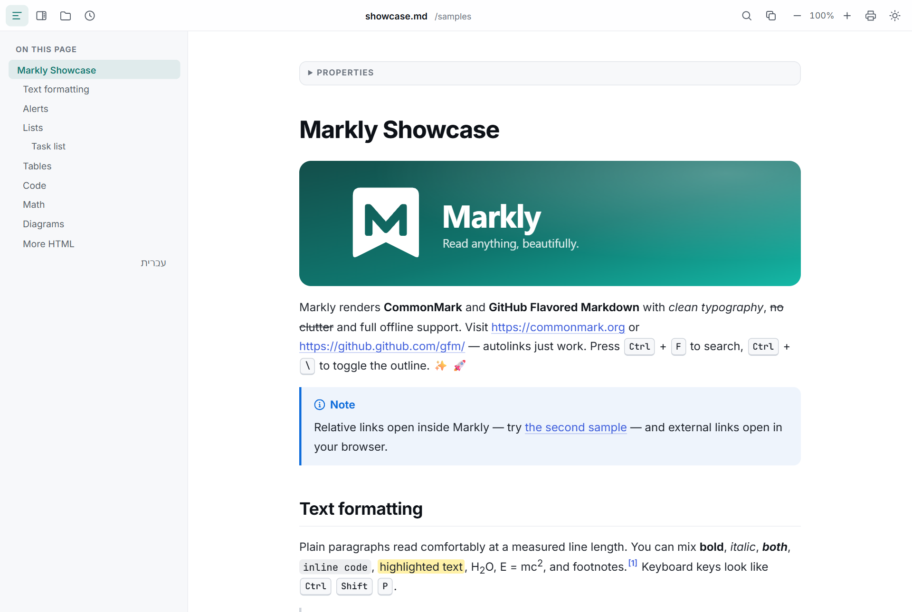
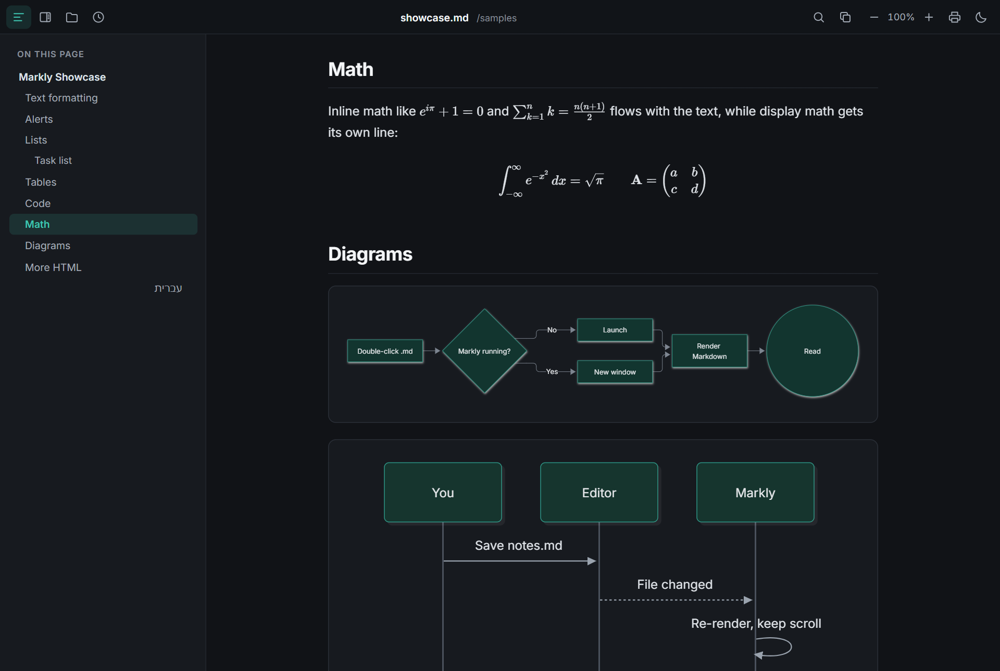
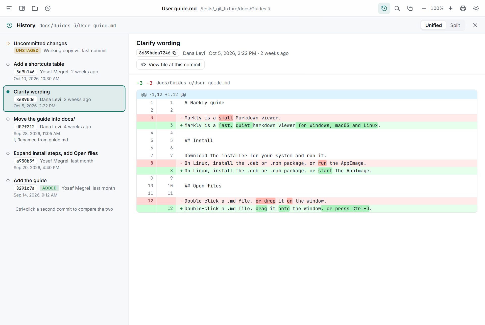
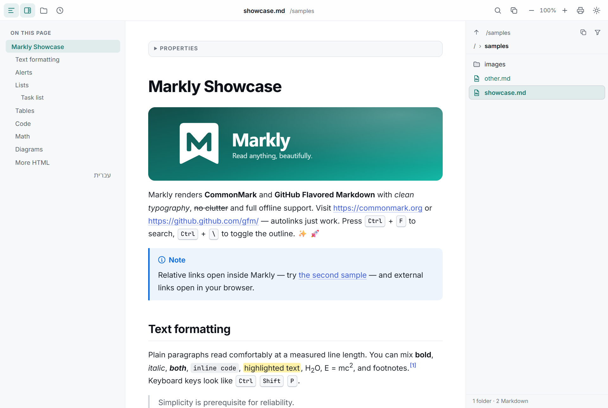
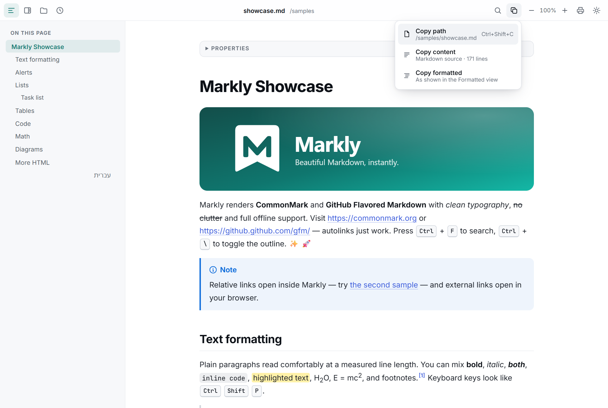
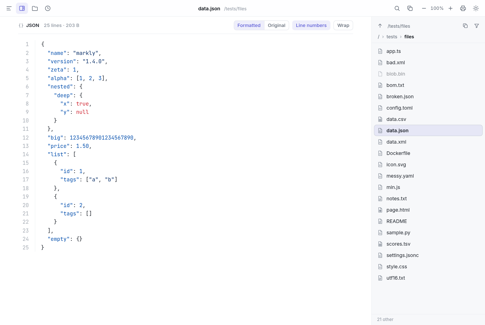

# Markly

**Read anything, beautifully.** Markly is a lightweight viewer for Windows, Linux and macOS: Markdown
fully rendered, plus plain text, code, config and data files (highlighted, formatted, CSV as a table).
It is a small native shell built with [Tauri 2](https://tauri.app) on top of the system web view
(WebView2 on Windows, WebKitGTK on Linux, WKWebView on macOS), so the app itself is only a few MB. It
reads files and never edits them, and it sends no telemetry.








## Download

From the [latest release](../../releases/latest):

| Platform | File |
|---|---|
| Windows 10/11 x64 | `Markly_1.5.0_x64-setup.exe` (installer) or `Markly_1.5.0_x64_portable.exe` |
| Debian / Ubuntu x64 | `Markly_1.5.0_amd64.deb` |
| Fedora / openSUSE x64 | `Markly-1.5.0-1.x86_64.rpm` |
| Any Linux x64 | `Markly_1.5.0_amd64.AppImage` |
| macOS 10.15+ (Intel and Apple silicon) | `Markly_1.5.0_universal.dmg` (unsigned) |

## Features

- CommonMark + GitHub Flavored Markdown: tables (wide ones scroll horizontally), task lists, strikethrough,
  autolinks, footnotes, heading anchors, GitHub alerts (`> [!NOTE]` and friends), `==highlight==`, emoji shortcodes
- Syntax highlighting (40+ languages) with copy buttons
- KaTeX math (`$…$`, `$$…$$`, ```` ```math ````) and Mermaid diagrams. Both load only when a document uses them.
- YAML front matter shown as a collapsible “Properties” panel
- Inter for text and JetBrains Mono for code, all bundled. Works fully offline.
- Light and dark themes that follow the system, plus a toggle (System → Light → Dark)
- Automatic right-to-left layout for Hebrew and Arabic paragraphs
- Table-of-contents sidebar, find, zoom, print / Save as PDF
- Folder browser panel on the right (Ctrl+Shift+E):
  - Shows the document's folder with breadcrumbs, an Up button and a copyable full path.
  - Click a file to open it: Markdown (accent colour), or text, code and data files (muted, with a type icon). Double-click a folder to go into it.
  - Other files are dimmed and never opened. Hidden files are not shown (except `.env` files).
  - File type filter: show every file, only the files Markly opens, or pick any mix of the types
    found in the folder (Markdown, JSON, Python, …, each with a count). Full keyboard navigation.
  - Resizable, refreshes when the folder changes, and remembers its state.
- File history for files tracked in Git (Ctrl+Shift+H):
  - Lists every commit that changed the file, following renames, with short hash, subject, author and
    relative and local date, plus an *Uncommitted changes* entry when the working copy differs.
  - Click a commit to see how the file changed in it: GitHub-style green/red lines with line numbers and
    hunk headers, word-level highlights, and a Unified / Split (side-by-side) toggle.
  - *View file at this commit* renders the Markdown as it was then, read-only, with a banner to go back.
  - Ctrl+click a second commit to compare two commits. Each hash has a copy button.
  - Uses the `git` you already have installed, only reads the repository, and loads only when first opened.
- Copy button next to Find: **Copy path** copies the file's full path, and **Copy content** copies the raw
  Markdown source exactly as it is on disk, not the rendered page. Ctrl+Shift+C copies the path.
- Opens files from the command line, by double-click or *Open with*, by drag and drop, or with Ctrl+O (⌘O on macOS). Keeps a list of recent files.
- Relative images and links resolve from the document's folder. Links to `.md` files (and to text, code and data files) open in Markly
  (Alt+← goes back), and web links open in your default browser (also with middle-click); hovering a link shows its
  real address. URLs in code blocks and in text, code and data files open with Ctrl+click, so a plain click still
  selects text.
- Right-click selected text to copy it or search Google for it (or open it, when it is a web address); right-click a link
  to open it or copy its address.
- Pins and highlights, to find your way back in long files:
  - Right-click a paragraph, heading, list item or code line and choose *Pin this spot* (Ctrl+F2 pins the top of the
    window). F2 / Shift+F2 go to the next / previous pin.
  - Select text, right-click and choose *Highlight*. Right-click it again to remove it.
  - Both are listed in the sidebar under the contents (it opens for them in files without headings too). They follow
    their text when the file is edited, and are kept by Markly per file: the file itself is never changed.
- Reopening a file continues where you left off (a link to it still opens at the top).
- Reloads automatically when the file changes on disk and keeps your scroll position
- Remembers window size, position, theme, zoom and sidebar state
- Strips scripts and unsafe HTML from documents, and never launches executables from links
- Also opens text, code and data files (see [Supported file types](#supported-file-types)):
  - Highlighted code with line numbers, a readable plain-text view, CSV/TSV as a sortable table, and
    HTML as source or a sandboxed preview.
  - A **Formatted / Original** toggle shows JSON, YAML, XML/SVG, HTML, CSS and JS/TS nicely formatted
    (Prettier-style) without ever changing the file. *Copy formatted* copies what you see.

## Supported file types

| Type | Extensions | View |
|---|---|---|
| Markdown | `.md` `.markdown` `.mdown` `.mkd` `.mkdn` `.mdwn` `.mdx` | Rendered document |
| Plain text | `.txt` `.text` `.log` `.out` `.nfo` `.rst` `.adoc`, and `README`, `LICENSE`, `CHANGELOG`, `AUTHORS`, … without extension | Wrapped reading view; optional line numbers and monospace |
| JSON | `.json` `.jsonc` `.json5` `.geojson` | Highlighted; formatted by default (key order and comments kept) |
| YAML | `.yaml` `.yml` | Highlighted; formatted by default |
| XML / SVG | `.xml` `.svg` `.xsd` `.xsl` `.plist` | Highlighted; formatted by default (SVG shown as text) |
| HTML | `.html` `.htm` `.xhtml` | Source (formatted) or sandboxed Preview |
| CSS | `.css` `.scss` `.less` | Highlighted; formatted by default |
| JavaScript / TypeScript | `.js` `.mjs` `.cjs` `.jsx` `.ts` `.tsx` `.mts` `.cts` | Highlighted; formatted by default |
| Config | `.toml` `.ini` `.cfg` `.conf` `.env` (also `.env.local`, `.env.example`, …) `.properties` `.editorconfig` `.gitignore` | Highlighted |
| Data | `.csv` `.tsv` | Sortable table, or Raw |
| Code | `.py` `.sql` `.sh` `.bash` `.zsh` `.ps1` `.bat` `.cmd` `.rs` `.go` `.java` `.c` `.h` `.cpp` `.hpp` `.cs` `.rb` `.php` `.kt` `.swift` `.lua` `.pl` `.r` `.diff` `.graphql` `.proto`, `Dockerfile`, `Makefile` | Highlighted with line numbers |

Files over 1 MB are shown as written (not formatted), files over 5 MB as plain text, and binary files
with a short "not a text file" note. Installers add Markly to *Open with* for `.txt .log .json .yaml
.yml .toml .ini .csv .xml .html .htm .css .js .ts .py`, but never make it the default for them.

## Shortcuts

The keyboard shortcuts, and what clicks and right-clicks do. On macOS use ⌘ wherever the table says
Ctrl (⌘[ and ⌘] also go back and forward).

| To | Do this |
|---|---|
| **Files** | |
| Open a file | Ctrl+O, or drop it on the window |
| Browse the folder | Ctrl+Shift+E, then ↑ ↓ to move, Enter to open, Backspace for the parent folder, type to jump, Esc to return |
| See the file's Git history | Ctrl+Shift+H, then ↑ ↓ to pick a commit, Enter to view the file at it, Ctrl+click a second commit to compare, Esc to close |
| Copy the file's path | Ctrl+Shift+C |
| Reload / close the window | F5 / Ctrl+W |
| **Move around** | |
| Find, then next / previous match | Ctrl+F, then Enter / Shift+Enter (or F3 / Shift+F3) |
| Show or hide the contents | Ctrl+\ |
| Go to the top / end | Home / End |
| Go back / forward between linked files | Alt+← / Alt+→, or the mouse's back and forward buttons |
| Continue where you left off | Just reopen the file |
| **Pins and highlights** (kept by Markly; the file is never changed) | |
| Pin a spot to come back to | Right-click it and choose *Pin this spot*, or Ctrl+F2 to pin the top of the window (again to unpin) |
| Jump to the next / previous pin | F2 / Shift+F2 |
| Highlight text | Select it, right-click and choose *Highlight* (right-click it again to remove) |
| Go to a pin or highlight | Click it in the sidebar under the contents |
| **Links and text** | |
| Open a link (web links open in your browser) | Click, or middle-click |
| Open a URL inside code or plain text | Ctrl+click |
| Copy a link, or search Google for selected text | Right-click |
| **View** | |
| Zoom in / out / reset | Ctrl+= / Ctrl+- / Ctrl+0, or Ctrl+mouse wheel |
| Switch theme (System → Light → Dark) | Ctrl+Shift+L |
| Print or save as PDF | Ctrl+P |

## Install

### Windows

Run `Markly_1.5.0_x64-setup.exe`. It installs for the current user only, so no admin prompt.
The installer registers Markly as an **Open with** handler for `.md`, `.markdown`, `.mdown` and `.mkd`. It does
not take over an existing default app. To make Markly the default, right-click a `.md` file and choose
*Open with → Choose another app → Markly → Always*, or use *Settings → Apps → Default apps → Markly*.
If no app was registered for `.md` before, Markly becomes the handler.

There is also a portable option: `Markly_1.5.0_x64_portable.exe` runs without installing, but it
does not register file associations.

The binaries are not code-signed, so Windows SmartScreen may warn you the first time.
Click **More info → Run anyway**.

### Linux

- Debian/Ubuntu: `sudo apt install ./Markly_1.5.0_amd64.deb`
- Fedora/RHEL/openSUSE: `sudo dnf install ./Markly-1.5.0-1.x86_64.rpm` (or `zypper install`)
- AppImage: `chmod +x Markly_1.5.0_amd64.AppImage && ./Markly_1.5.0_amd64.AppImage file.md`.
  It is large (~105 MB) because it bundles WebKitGTK. Prefer the deb/rpm where possible.

The deb and rpm install `markly` to `/usr/bin` and a desktop entry for `text/markdown`, so Markly shows
up under *Open With*. Your desktop keeps any existing default app. To make Markly the default, run
`xdg-mime default Markly.desktop text/markdown`. Needs WebKitGTK 4.1 (`libwebkit2gtk-4.1-0`, which the
packages pull in).

### macOS

Open the `.dmg` and drag Markly to *Applications*. The app is **not signed or notarized**, so the first
launch is blocked by Gatekeeper. Either right-click Markly in *Applications* → **Open** → **Open**, or run:

```bash
xattr -dr com.apple.quarantine /Applications/Markly.app
```

Markly is registered as a viewer for `.md`, `.markdown`, `.mdown` and `.mkd`, as an alternate handler.
It appears under *Open With* without becoming the default. To make it the default, use
*Get Info → Open with → Markly → Change All…*.

## Performance

1.1 renders faster than 1.0, and its output is unchanged: screenshots are pixel-identical in light and
dark, and the rendered HTML is identical. Measured on the same Linux box with the same method for both
versions. Desktop timings come from headless Chrome (`node tools/bench.mjs`): each figure is the median
of 7 cold runs, averaged over 2 interleaved rounds. Memory and size come from the real binaries
(`tools/linux-rss.sh`, Xvfb, 10 s idle).

| Metric | 1.0.0 | 1.1.0 | Change |
|---|---:|---:|---:|
| Start-up JS + CSS | 455 + 46 KB | 247 + 24 KB | −46% |
| Start-up download (gzip) | 169 KB | 98 KB | −42% |
| First render, text-only doc (3,400 words) | 393 ms | 269 ms | −32% |
| First render, `showcase.md` (code, math, diagrams) | 689 ms | 614 ms | −11% |
| `showcase.md` fully ready (math + diagrams drawn) | 1257 ms | 1194 ms | −5% |
| JS heap, text-only / showcase | 2.9 / 15.1 MB | 2.3 / 14.7 MB | −0.6 / −0.4 MB |
| Renderer memory (PSS), text-only / showcase | 77 / 114 MB | 76 / 115 MB | ≈ same |
| Windows installer | 3.49 MiB | 3.41 MiB | −2.5% |
| Windows portable exe | 5.53 MiB | 5.06 MiB | −8.5% |
| Linux binary | 6.80 MiB | 6.41 MiB | −5.7% |
| Linux idle memory, showcase open (app + WebKit processes, PSS) | ~461 MB | ~460 MB | ≈ same |

**1.2.0 vs 1.1.0, with the folder browser closed.** The Copy button and the folder browser don't slow
start-up. Same method, median of 7 runs averaged over 3 interleaved rounds. This was a later session on
a busier machine, so compare numbers within one table, not across tables:

| Metric | 1.1.0 | 1.2.0 |
|---|---:|---:|
| Start-up JS + CSS | 247.1 + 24.1 KB | 249.5 + 25.2 KB |
| Start-up download (gzip) | 98.4 KB | 99.8 KB |
| Requests, text-only / showcase | 8 / 62 | 8 / 62 |
| First render, text-only doc | 290 ms | 294 ms (within noise) |
| First render, `showcase.md` | 671 ms | 670 ms |
| JS heap, text-only / showcase | 2.3 / 14.7 MB | 2.3 / 14.8 MB |

The folder browser's script (9.4 KB) and stylesheet (3.5 KB) load only when the panel is first opened.

**1.3.0 vs 1.2.0, with the history closed.** The file history doesn't slow start-up or change the
rendered page (screenshots pixel-identical, HTML identical). Same method, median of 7 runs averaged over 3
interleaved rounds, measured in one session:

| Metric | 1.2.0 | 1.3.0 |
|---|---:|---:|
| Start-up JS + CSS | 249.5 + 25.2 KB | 251.4 + 25.3 KB |
| Start-up download (gzip) | 99.8 KB | 100.5 KB |
| Requests, text-only / showcase | 8 / 62 | 8 / 62 |
| First render, text-only doc | 252 ms | 256 ms (within noise) |
| First render, `showcase.md` | 579 ms | 576 ms |
| `showcase.md` fully ready | 1129 ms | 1124 ms |
| JS heap, text-only / showcase | 2.3 / 14.8 MB | 2.3 / 14.8 MB |
| Renderer memory (PSS), text-only / showcase | 76.0 / 115.5 MB | 76.5 / 115.5 MB |
| Windows installer / portable exe | 3,583,396 / 5,328,896 B | 3,611,192 / 5,400,064 B (+27 / +70 KB) |
| Linux binary | 6,742,848 B | 6,817,344 B (+73 KB) |

The history's script (18 KB) and stylesheet (10 KB) load only when it is first opened. Whether a file is
tracked is checked after the document is shown: Markly looks for a `.git` folder, and only then runs one
`git ls-files` (about 1 ms) off the UI thread. Markly calls the `git` command-line tool rather than
bundling a Git library: a minimal build using the `gix` crate for the same operations was about 1.8 MB
larger.

Where the 1.1 gains come from:
- The text font is preloaded, and Chromium's default `text-rendering` is used, so the first layout is not
  redone when the font arrives.
- highlight.js loads only the grammars a document uses, the YAML parser loads only for front matter, and
  KaTeX's stylesheet loads only with KaTeX.
- The table of contents is built before the first layout.
- The Rust binary is optimized for size.

## Build

You need Node 20+, Rust (stable) and the Tauri CLI: `cargo install --locked tauri-cli@^2`.

**Windows (on Windows):** `npm install`, then `cargo tauri build`. The output is in `src-tauri/target/release/bundle/nsis/`.

**Windows (cross-compiled from Linux, used for the release builds):**

```bash
rustup target add x86_64-pc-windows-msvc
cargo install --locked cargo-xwin
sudo apt install nsis lld llvm clang    # plus: ln -s clang-cl-19 /usr/local/bin/clang-cl
./build-windows.sh                      # installer + portable exe in dist/
```

**Linux:**

```bash
sudo apt install libwebkit2gtk-4.1-dev libgtk-3-dev librsvg2-dev libayatana-appindicator3-dev patchelf file dpkg-dev
./build-linux.sh                        # .deb, .rpm, .AppImage in dist/
```

**macOS:** `npm install`, then
`rustup target add aarch64-apple-darwin x86_64-apple-darwin && cargo tauri build --target universal-apple-darwin`.

**CI / releases:** `.github/workflows/ci.yml` builds every push and pull request on all three
platforms. Pushing a tag such as `v1.5.0` runs `.github/workflows/release.yml`, which creates a GitHub
release with the Windows installer and portable exe, the Linux deb/rpm/AppImage and the macOS dmg.
To rebuild an existing tag, run `gh workflow run release.yml --ref main -f tag=v1.5.0`. It reuses
that tag's release, whether it is a draft or published, and replaces assets that have the same names.

Frontend only: `npm run build` (writes `dist-web/`). Then:
- `node tools/screenshot.mjs` renders the sample in headless Chrome.
- `node tools/interact.mjs` runs the UI checks (it builds a small Git repository with
  `tools/make-git-fixture.sh` for the history tests).
- Both use the browser in `CHROME` (default `/usr/bin/google-chrome`). On Windows, point it at any Chrome
  or Chromium, such as Playwright's (`%LOCALAPPDATA%\ms-playwright\chromium-*\chrome-win64\chrome.exe`). In
  Git Bash, add `MSYS_NO_PATHCONV=1` before passing a `/samples/…` path, or Bash rewrites it.
- `cargo test --manifest-path src-tauri/Cargo.toml` runs the Rust tests (git commands on a temporary repository).
- `node tools/bench.mjs` measures first-render time and memory.

## Layout

```
src/            frontend (vanilla JS + CSS, bundled by esbuild)
  app.js        UI: loading, TOC, find, zoom, theme, links, shortcuts
  render.js     markdown-it pipeline + DOMPurify + Mermaid
  math.js       $/$$ math plugin, lazy KaTeX
  files.js      folder browser panel (lazy-loaded with files.css)
  history.js    file history view; diff.js parses and renders diffs (lazy-loaded with history.css)
  marks.js      pins and highlights (lazy-loaded with marks.css)
  host.js       Tauri bridge (or plain-browser fallback for previews)
src-tauri/      Rust shell: file reading, file watching, CLI args, window state
  src/git.rs    read-only git commands for the file history (runs the git CLI)
  windows/hooks.nsh   Windows installer file-association hooks
  linux/markly.desktop  Linux desktop entry (deb/rpm/AppImage)
  tauri.{windows,linux,macos}.conf.json  per-platform bundle settings
samples/        showcase documents
tools/          screenshot, interaction test and benchmark scripts
```

## Version history

All releases so far, newest first. See [CHANGELOG.md](CHANGELOG.md) for full details.

### 1.5.0 — 2026-10-23
- **New look**: a teal accent replaces the purple, with a new bookmark icon. Secondary text is easier
  to read in both themes.
- **Folder browser filter by file type**: show every file, only the files Markly opens, or any mix
  of the types found in the folder, each with a count.
- **`.env` files** (and `.env.local`, `.env.example`, …) open highlighted and appear in the folder
  browser.
- Large folders list about 40% faster.

### 1.4.0 — 2026-10-13
- **Text, code and data files**, read-only like Markdown:
  - Plain text in a readable, wrapped view; extension-less README/LICENSE files too.
  - Highlighted code and config with line numbers, for 40+ languages.
  - CSV/TSV as a sortable table, and HTML as source or a sandboxed, script-free preview.
  - A Formatted / Original toggle (Prettier-style) for JSON, YAML, XML/SVG, HTML, CSS and JS/TS. It
    never changes the file. *Copy formatted* copies what you see.
  - Openable from the folder browser, and offered in *Open with* (never as the default).
- Opening Markdown is as fast as before: all of this loads only when such a file is opened.
- Fix: closing the folder browser with Esc no longer leaves focus in the hidden list.

### 1.3.0 — 2026-10-12
- **File history** for files tracked in Git (History button or Ctrl+Shift+H):
  - Every commit that changed the file, following renames, plus uncommitted changes.
  - Each commit's diff of the file, inline or side by side, with word-level highlights.
  - View the rendered file as it was at any commit, or compare two commits.
  - Read-only, uses the installed `git`, and loads only when first opened.

### 1.2.0 — 2026-10-08
- **Folder browser** panel on the right (Ctrl+Shift+E):
  - Breadcrumbs, an Up button and the folder path (copyable).
  - Click Markdown files to open them. Other files are dimmed and never launched.
  - The current file is highlighted and followed. Optional only-Markdown filter.
  - Keyboard navigation, resizable, auto-refreshing, and loaded only when first opened.
- **Copy button** next to Find: copy the file's path (Ctrl+Shift+C) or its raw Markdown source.
- Release workflow fixed: installers are attached reliably, and existing tags can be rebuilt.
- macOS release is a universal `.dmg` (Intel and Apple silicon).

### 1.1.0 — 2026-10-08
- **Faster**: the start-up bundle is 46% smaller (501 → 271 KB). First render is 32% faster for
  text-only documents (393 → 269 ms) and 11% faster for the showcase (689 → 614 ms). Output is
  pixel-identical.
- **Linux** (`.deb`, `.rpm`, `.AppImage`) and **macOS** (`.dmg`, unsigned) support, with *Open With*
  registration and Finder double-click handling.
- CI builds for all three platforms, and a tag-triggered release workflow.
- Links to scripts, launchers and installers for macOS and Linux are blocked too, not only Windows ones.

### 1.0.0 — 2026-10-08
- First release: a lightweight Markdown viewer for Windows (Tauri 2 + WebView2).
- GitHub Flavored Markdown, syntax highlighting, KaTeX math, Mermaid diagrams, front matter, RTL text.
- Light/dark themes, table of contents, find, zoom, print / PDF, recent files, auto-reload.
- Sanitized HTML, no launching of executables, per-user installer, *Open with* without taking over `.md`.

## License

[MIT](LICENSE)
